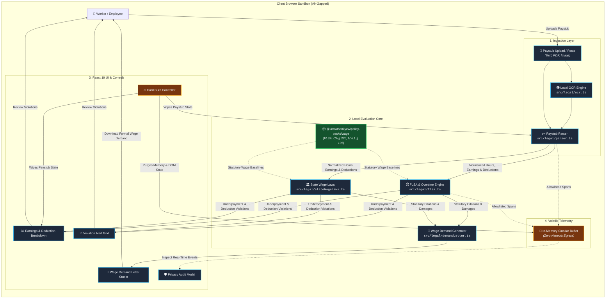
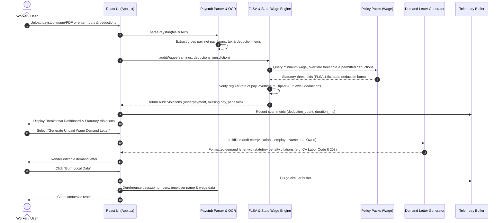

<!-- diagram-meta
  last-validated: 2026-10-26
  validated-commit: 7ff28fe
  covers: [src/**]
  generated-by: manual
-->

# Architecture & Invariants Specification: Paystub Check Reality Engine

> Client-side paystub auditor, wage theft detection engine, FLSA overtime calculator, and statutory wage demand generator.

---

## 1. Executive Summary

`paystub-check` is a client-side reality engine in the `knowthankyew` portfolio built to protect workers from wage theft and improper payroll deductions. Operating under zero-egress local processing, it extracts paystub earnings and itemized deductions (via text, PDF, or local image OCR), tests pay against the Fair Labor Standards Act (29 U.S.C. § 201) and state Wage Theft Prevention Acts (e.g. CA Labor Code § 226, NYLL § 195), and synthesizes statutory unpaid wage demand letters.

---

## 2. System Architecture & Component Interactions

### A. Execution Sandbox & Trust Boundary



### B. Wage Audit & Demand Notice Lifecycle



---

## 3. Core Architectural Invariants

| # | Invariant | Enforcement & Guarantee |
|:--|:----------|:------------------------|
| 1 | **Zero Document Egress** | Paystubs, SSNs, employer names, and compensation numbers never leave the local browser sandbox. |
| 2 | **Volatile Memory Telemetry** | Operational events are held strictly in an in-memory ring buffer for the local privacy modal; zero network export in consumer builds. |
| 3 | **Strict Key Allowlists** | Telemetry sanitizes properties against `SAFE_ALLOWLIST_KEYS`; gross pay amounts, employer identifiers, and worker names are redacted. |
| 4 | **Compile-Time Dead Code Shims** | Enterprise network telemetry exporter code is excised at compile time for public consumer builds. |
| 5 | **Amnesiac State Purge (Hard Burn)** | Complete memory purge removing all wage figures, deduction tables, and canvas buffers. |

---

## 4. Directory Structure

```
paystub-check/
├── docs/
│   ├── ARCHITECTURE.md          # Architecture, data flow & invariant specification
│   └── PRIVACY_TELEMETRY_SCHEMA.md # Telemetry contract specification
├── src/
│   ├── App.tsx                  # Root application view & workflow orchestration
│   ├── main.tsx                 # Entrypoint
│   ├── index.css                # Tailwind CSS v4 styling
│   ├── components/              # UI components (Dropzone, Dashboard, Alerts, DemandStudio, PrivacyModal)
│   └── legal/
│       ├── parser.ts            # Paystub line-item extraction & OCR parser
│       ├── flsa.ts              # FLSA overtime & minimum wage calculation
│       ├── stateWageLaws.ts     # State wage theft prevention rules
│       ├── policy-loader.ts     # Ingestion of @knowthankyew/policy-packs/wage
│       ├── demandLetter.ts      # Statutory unpaid wage demand generator
│       ├── ocr.ts               # Local OCR engine for scanned paystubs
│       ├── samplePaystubs.ts    # Synthetic test paystubs
│       ├── telemetry.ts         # In-memory privacy telemetry controller
│       └── types.ts             # TypeScript domain definitions
├── tests/                       # Vitest unit test suites
└── vite.config.ts               # Air-gapped bundler configuration
```
